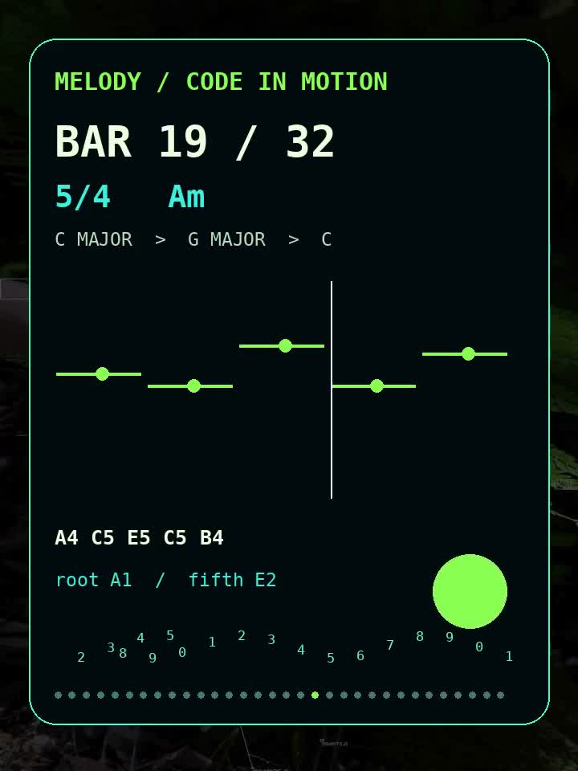

# Live Coding · 32 такта

Музыкальная идея Снежаны как TypeScript-партитура, визуальная серия и звуковой эскиз. Это текущая презентация проекта от 26 октября 2026 года.

<table><tr><td width="50%" valign="top"> Обложка · визуальный эскиз</td><td width="50%" valign="top"> <a href="media/melody-32-bars-neon-motion.mp4">Смотреть и слушать анимацию (MP4)</a></td></tr></table>

## Начать здесь

1. [Посмотреть 11 карточек в PDF](presentations/melody-32-bars.pdf) или [открыть карточки по отдельности](cards/32-bars/).
2. [Прочитать полный исходный код](scores/melody-32-bars.ts): мелодия, аккорды, бас и события во времени.
3. [Послушать звуковой эскиз](media/melody-32-bars-neon.wav) или посмотреть анимацию выше.
4. [Пройти короткий учебный маршрут](LEARNING-PATH.md) и [прочитать заметки о форме](PROJECT-NOTES.md).

## О произведении

32 такта · смена размеров 4/4, 3/4 и 5/4 · 128 долей. Музыкальная форма движется от C major к временному центру G major через D7 и возвращается к C major. Смысловой пик находится около 20-го такта — рядом с золотым сечением 32-тактовой формы.

Карточки — визуальная презентация; точная полная запись нот и длительностей находится в TypeScript-файле. Звуковой файл и MP4 — синтезированные демонстрационные версии, не запись живого исполнения. MP4 содержит звук, поэтому это не GIF.

## Состав презентации

- [Обложка 32 тактов](cards/live-coding-cover-32.png) — первый визуальный эскиз.
- [11 карточек](cards/32-bars/) и [единый PDF](presentations/melody-32-bars.pdf).
- [TypeScript-партитура](scores/melody-32-bars.ts).
- [Озвученная анимация](media/melody-32-bars-neon-motion.mp4) и [WAV](media/melody-32-bars-neon.wav).

Прежняя 16-тактовая презентация заменена текущей; её этапы доступны в истории Git. Материалы опубликованы для просмотра. Лицензия на повторное использование не предоставлена.

## Статус и продолжение

**Готово:** 32-тактовая партитура, 11 карточек, PDF, обложка и озвученный синтезированный эскиз. **Следующий музыкальный шаг:** прослушать эскиз и отметить правки мелодии и аранжировки. **Следующий технический шаг, если потребуется:** воспроизведение из TypeScript через MIDI или синтезатор. Это отдельная задача; текущий код создаёт события, но сам не звучит.
