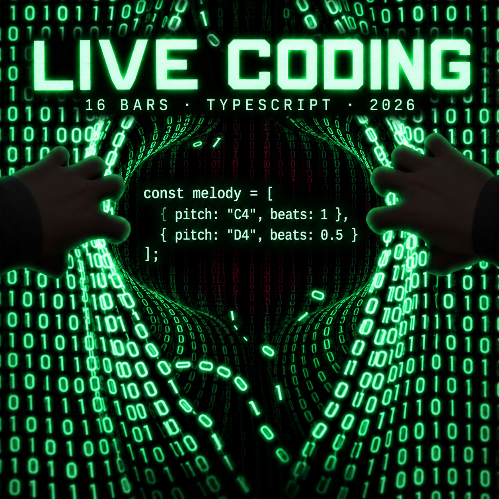

# Live Coding

**Музыка → ноты и длительности → код → визуальная презентация.** Здесь Снежана исследует, как музыкальную идею описать точными правилами и превратить в материал, с которым можно учиться и экспериментировать. Неоновая обложка — первый визуальный эскиз проекта; она остаётся главным изображением страницы.

## Начать здесь

1. **Посмотреть результат:** [семь карточек в одном PDF](presentations/16-bars-code-cards.pdf) или [по одной карточке](cards/16-bars-series/).
2. **Увидеть исходник:** [16-тактовая TypeScript-партитура](scores/2026-10-26-melody-presentation.ts). В ней записаны мелодия, гармония, бас и смены размера.
3. **Разобраться в устройстве:** [короткий маршрут для начинающего](LEARNING-PATH.md) объясняет `pitch`, `beats`, такт и события.

Это **завершённая визуальная презентация 16-тактовой идеи**, но не готовая аудиозапись. TypeScript собирает нотные события; для воспроизведения понадобится синтезатор, MIDI-экспорт или отдельная версия для Strudel.

## Визуальные версии

- [Главная неоновая обложка](cards/live-coding-cover-v2.png) — эскиз визуальной идентичности Live Coding.
- [Семь карточек с оригинальным кодом](cards/16-bars-series/) — последовательность от модели данных через 16 тактов к событиям.
- [Чёрно-зелёная карточка мелодии](cards/melody-matrix-release.png) и [первый зелёный вариант](cards/2026-10-26-melody-v1.jpg) — сохранённые этапы оформления, не замена полной партитуры.
- [Карточка «мелодия → Strudel»](visuals/strudel_handwritten_melody_code.png) — более раннее визуальное исследование.

Фрагмент кода на обложке служит визуальным знаком проекта; точный полный код находится в `scores/`. Соответствие всех нот рукописного листа и цифровой партитуры пока не подтверждено.

## Код и эксперименты

- [`scores/`](scores/) — TypeScript-версии 16-тактовой мелодии. Файл презентации соответствует семи карточкам; [версия, присланная Снежаной 26 октября](scores/2026-10-26-melody.ts) сохранена отдельно.
- [`melody/`](melody/) — отдельный мотив и рабочая версия мелодии.
- [`strudel/`](strudel/) — ранние музыкальные эскизы на 16, 64 и 128 тактов. Их можно по одному вставлять в [редактор Strudel](https://strudel.cc/) и слушать; начни с небольшой громкости. TypeScript-файлы из `scores/` нельзя вставить туда напрямую.

## Что дальше

Первый новый технический этап — сделать слышимую версию 16-тактовой партитуры и сопоставить её с карточками. Затем можно добавить короткое объяснение решений в аранжировке и обновить визуальную серию, сохранив эту версию как этап работы.

Материалы опубликованы для просмотра, не как подтверждение живого выступления или готового музыкального релиза. Лицензия на повторное использование пока не предоставлена; роли участников и происхождение исходной рукописной мелодии уточняются.
